# Surveillance Capitalism Omarchy Theme

An Omarchy theme about being watched, built from *Person of Interest* and Shoshana Zuboff's *The Age of Surveillance Capitalism*. The desktop is the view from inside the system: a steel-blue night and ice-white type taken from the show's title sequence, an ice-white box around the focused window as the machine's classification frame, and a terminal that speaks only the machine's four words: threat red, admin yellow, government blue and irrelevant white.

## Preview

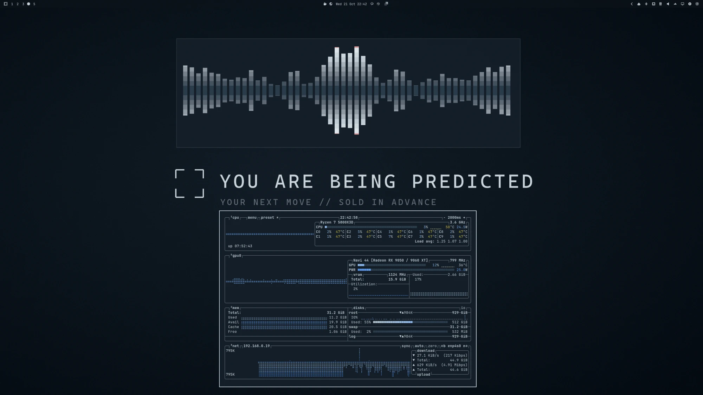

## Install

```bash
omarchy theme install https://github.com/Devis99/omarchy-surveillance-capitalism-theme
```

## What's Included

- Core Omarchy colours, an ice-white window border, and a menu and launcher whose selected row is drawn as the machine's box.
- App themes for Discord (Vencord), GTK, Zen, Zed, btop, cava and cliamp, plus Yaru-blue icons.
- A 12-wallpaper set in `backgrounds/`, all drawn for this theme.
- The palette as a Base24 scheme in `surveillance-capitalism-base24.yaml`.

## Palette

The ground and the text are measured from the *Person of Interest* opening titles: the slate-blue sky over a city whose details are lost, and the pale lettering above it. The signal colours are the boxes the show's machine draws around people, red for a threat, yellow for its admin, blue for government, white for everyone it considers irrelevant, each held at the saturation it has on screen.

Every other terminal colour is a shade of those four, so a successful command is not green but irrelevant white. Red is kept rare: it appears for errors, for hot readings in btop and cava, and for the notification countdown, which works like a recording light.

## Wallpapers

All wallpapers are 3840x2160 and original to this theme, drawn in the palette; walls 07, 09 and 11 are built on AI-generated images, and every box and label is drawn on top. Each title card is followed by its sentence taken literally. How each one was made is in `backgrounds/SOURCES.md`.

<table>
  <tr>
    <td>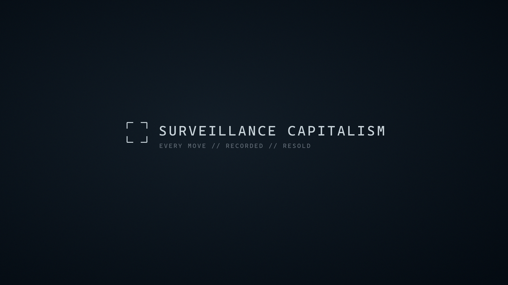<br><sub>01 Surveillance Capitalism</sub></td>
    <td>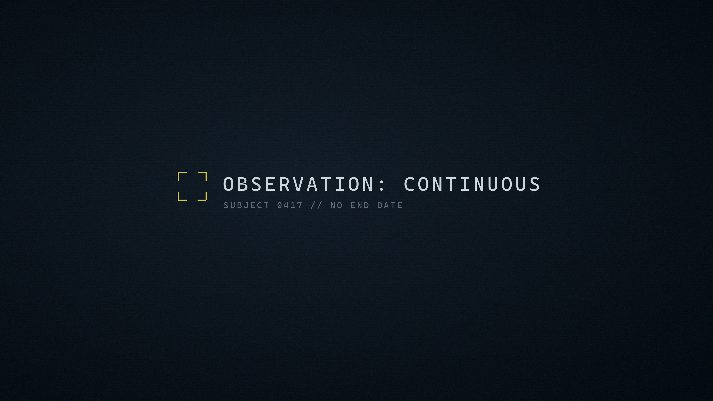<br><sub>02 Observation: Continuous</sub></td>
    <td>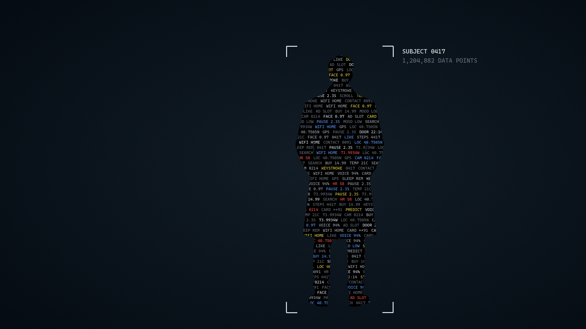<br><sub>03 Data Points — a person as the data kept on him</sub></td>
  </tr>
  <tr>
    <td>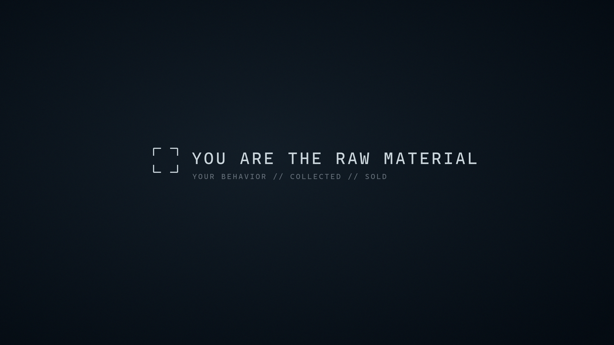<br><sub>04 You Are the Raw Material</sub></td>
    <td>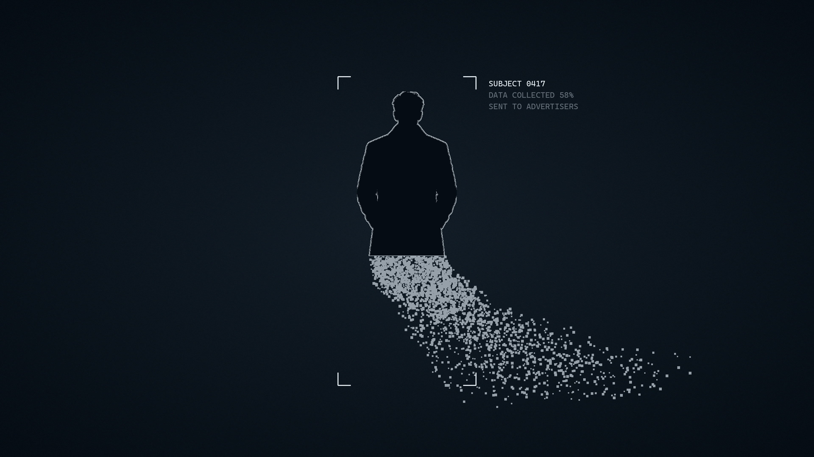<br><sub>05 Extraction — his data sent to advertisers</sub></td>
    <td>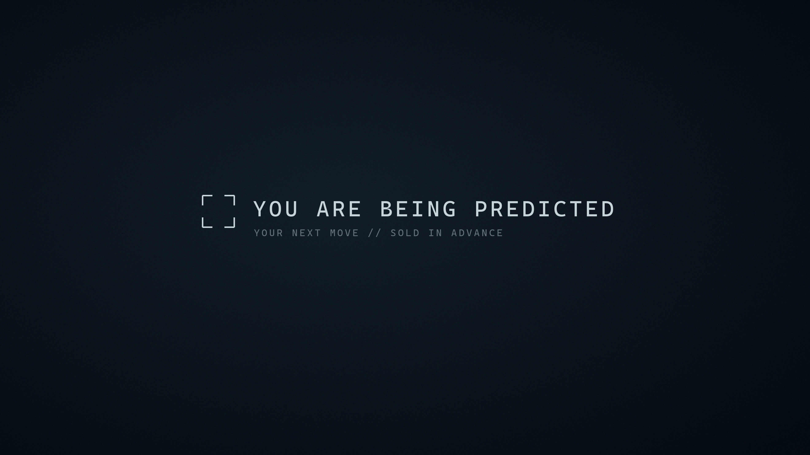<br><sub>06 You Are Being Predicted</sub></td>
  </tr>
  <tr>
    <td>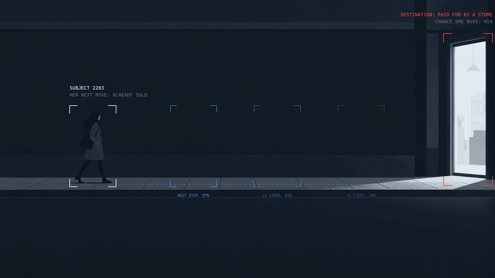<br><sub>07 Next Position — her arrival sold to a store</sub></td>
    <td>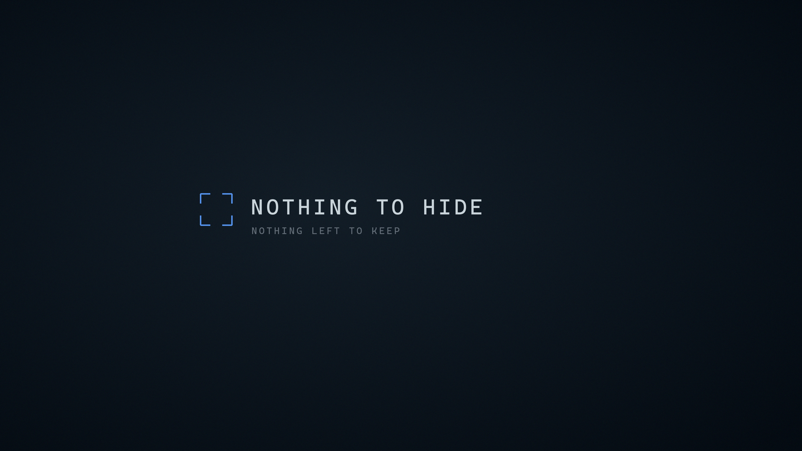<br><sub>08 Nothing to Hide</sub></td>
    <td>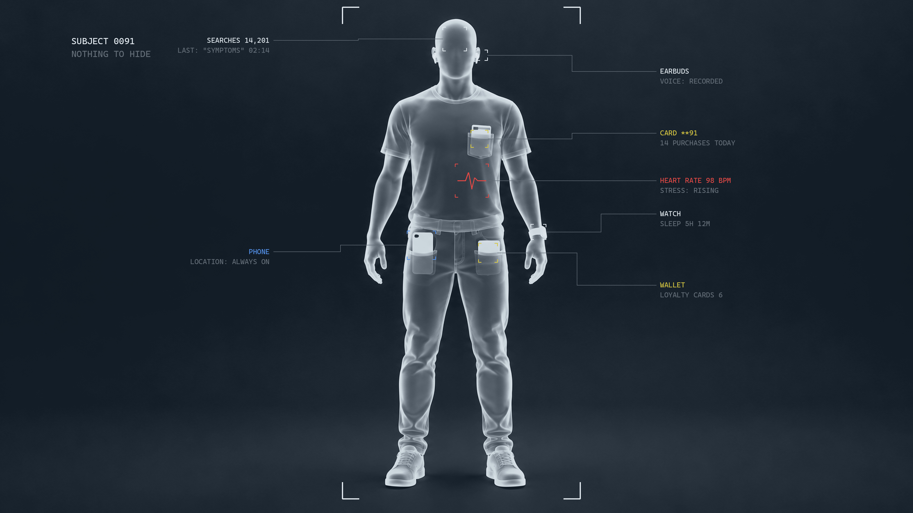<br><sub>09 Contents Indexed — everything readable from outside</sub></td>
  </tr>
  <tr>
    <td>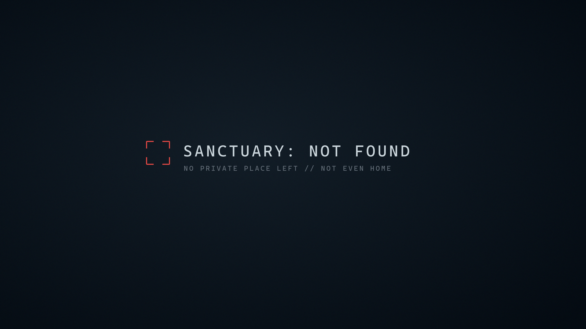<br><sub>10 Sanctuary: Not Found</sub></td>
    <td>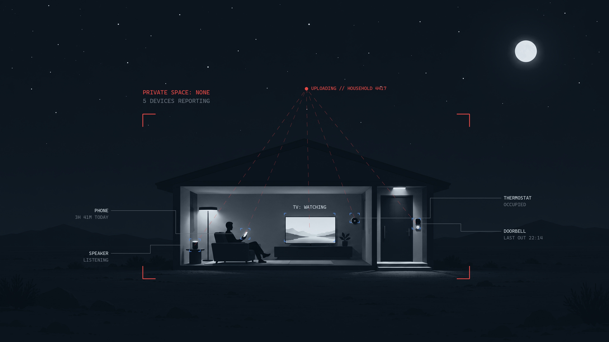<br><sub>11 Transparent Walls — every device reports out</sub></td>
    <td>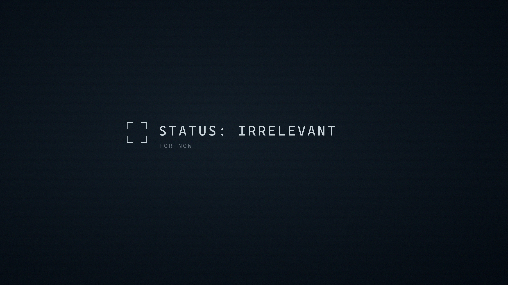<br><sub>12 Status: Irrelevant — for now</sub></td>
  </tr>
</table>
